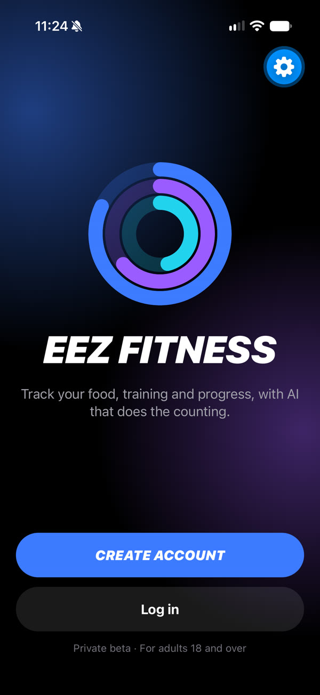
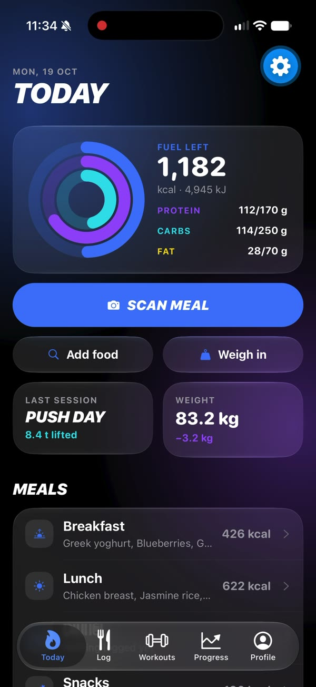
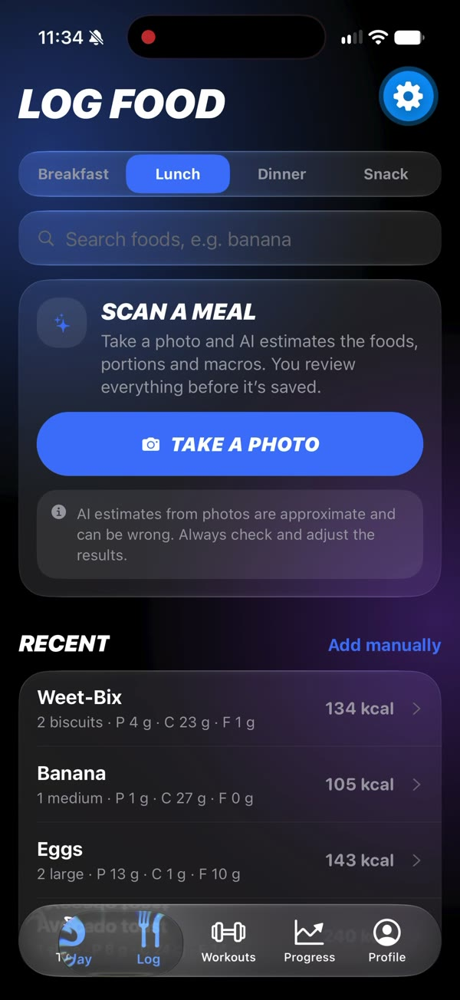
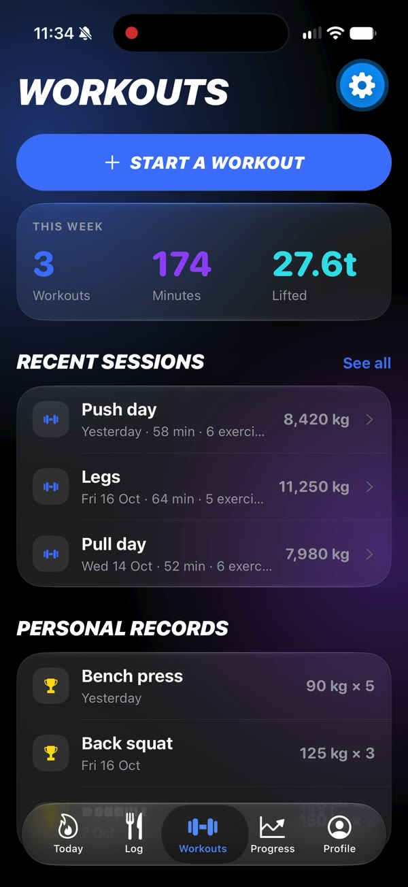
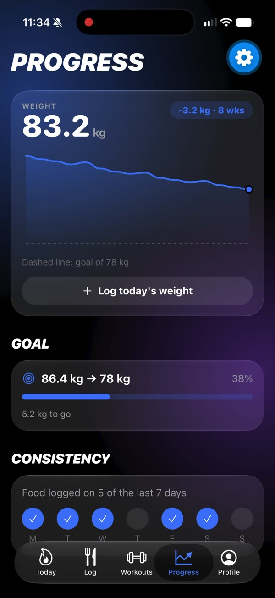
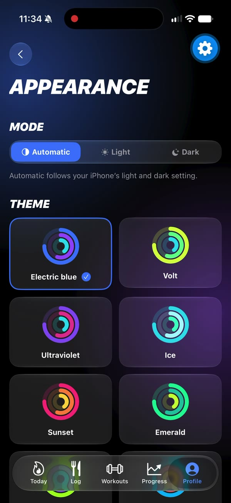
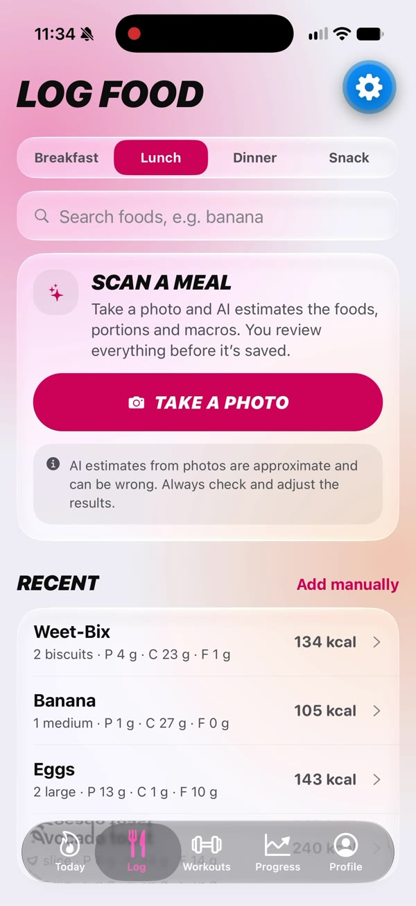

# EEZ Fitness

A cross-platform fitness and nutrition-tracking app built with **TypeScript**, **React Native (Expo)** and **Supabase**.

EEZ Fitness brings food logging, workouts and progress tracking together in one app, with calories and macros shown against your personal targets. Energy is also shown in kilojoules, the unit used on Australian food labels.

> **Status:** in active development. Accounts, onboarding, personal targets and the food diary (with Australian food search) are live; weight tracking and workout logging are live. The AI meal scanner is built and switched off until an AI key is added (see [docs/ai-scanner.md](docs/ai-scanner.md)).

## Screenshots

<p>
  
  
  
  
</p>
<p>
  
  
  
</p>

## Features

### Working now
- **Screens:** home dashboard, food log, workouts, progress and profile, built with Expo Router tab navigation
- **Custom UI components:** activity rings, line charts, progress bars and glass-effect cards
- **Appearance settings:** 10 colour themes, plus light and dark modes that follow the device or a manual choice

- **Accounts:** sign up (with 18+ confirmation and recorded consent), sign in, sign out and stay signed in (Supabase Auth)
- **Onboarding:** a four-step setup for personal details, goal, activity, diet and allergies
- **Personal targets:** daily calories and macros from the Mifflin–St Jeor equation, with a safe calorie floor and a capped deficit (unit-tested with Jest)
- **Editable profile:** update details, goal, diet and allergies; targets recalculate automatically
- **Food diary:** search 1,588 Australian foods (AFCD) and Australian packaged products (Open Food Facts), choose the amount and meal, add foods manually, and edit or remove entries; the Today dashboard shows real totals against your targets
- **Weight and progress:** daily weigh-ins and optional body measurements, a weight trend chart with goal line, goal progress, a 7-day food-logging streak and check-in history; the latest weight keeps calorie targets up to date
- **Workout logging:** 54 built-in exercises plus your own, sets with weight and reps, "last time" hints, unfinished workouts saved on the phone, history, weekly stats, and personal records with estimated one-rep max
- **AI meal scanner (switched off until an AI key is added):** take or choose a photo, a secure Supabase Edge Function asks Claude for structured estimates of each food, then you correct names and amounts before saving; daily scan limits, photos never stored
- **Account deletion:** permanently deletes the account and all of its data
- **Friendly error handling:** Supabase error codes are translated into plain-language messages

### Coming next
- Email verification codes and password reset by code (needs a custom email provider)
- Switch on the AI meal scanner (needs a paid AI API key)
- Data export

## Food data

- Whole and generic foods: **Australian Food Composition Database (AFCD) Release 3**, © Food Standards Australia New Zealand, licensed under [CC BY-SA 3.0 AU](http://creativecommons.org/licenses/by-sa/3.0/au/deed.en). Imported with `scripts/afcd/build_migration.py`; energy is converted from kJ to kcal. EEZ Fitness is not endorsed by FSANZ.
- Packaged products: **[Open Food Facts](https://world.openfoodfacts.org)**, available under the [Open Database License](https://opendatacommons.org/licenses/odbl/1-0/). Searched live; set `EXPO_PUBLIC_OFF_CONTACT_EMAIL` in `.env` so Open Food Facts can identify the app.

## Security
- **Row Level Security on every table.** Database rules ensure each user can only read and change their own rows; users can't change their own subscription plan or AI usage counters. `npm run test:privacy` proves this with two temporary users.
- **Reference food data is read-only**, and each user's food diary is private to them.
- **Account deletion runs in the database** and can only ever delete the caller's own account.
- **Encrypted sessions on the device.** Login sessions are designed to be encrypted with AES-256 before being saved. The encryption key is stored in the iOS Keychain or Android Keystore via Expo SecureStore, following Supabase's recommended approach for Expo apps.
- **AI key stays on the server.** The meal scanner's API key is a Supabase secret used only by the `analyse-meal` Edge Function, which verifies the user and enforces daily limits that users can't change.
- **No secrets in the app.** The app only uses Supabase's public publishable key. The secret service-role key is never included in the code.
- **Environment variables are kept out of Git.** Supabase settings live in a local `.env` file, which is ignored by Git; `.env.example` shows the format.
- **Sessions refresh only while the app is open**, as Supabase recommends.

## Tech stack

| Area | Tools |
|---|---|
| Language | TypeScript |
| App framework | React Native, Expo, Expo Router |
| Backend and auth | Supabase |
| Data fetching | TanStack Query |
| Database | PostgreSQL (Supabase) with SQL migrations in `supabase/migrations` |
| Secure storage | Expo SecureStore, AsyncStorage, aes-js |
| Animation and graphics | React Native Reanimated, React Native SVG |
| Testing and code quality | Jest, ESLint, TypeScript strict type checking |

## Project structure

```
src/
  app/          Screens (file-based routing)
    (auth)/        Welcome, sign up, sign in, verify, password reset
    (onboarding)/  First-time profile setup
    (tabs)/        Home, log, workouts, progress, profile
  components/   Reusable UI components
  providers/    Auth and appearance state
  hooks/        Data hooks (profile, theme)
  lib/          Supabase client, targets calculator, profile helpers
supabase/
  migrations/   Database tables and privacy rules (SQL)
  functions/    Server functions (AI meal scanner)
docs/           Guides (switching on the AI scanner)
scripts/        Privacy test and AFCD import
  constants/    Colours and themes
```

## Running locally

1. Install dependencies:
   ```bash
   npm install
   ```
2. Copy `.env.example` to `.env` and add your Supabase project URL and publishable key.
3. Apply the database migrations to your Supabase project:
   ```bash
   npx supabase link --project-ref <your-project-ref>
   npx supabase db push --remote
   ```
4. Start the app:
   ```bash
   npx expo start
   ```
   Then open it in Expo Go, an iOS simulator, an Android emulator or the web preview.
5. Run the tests:
   ```bash
   npm test
   npm run test:privacy
   ```

## About

Built by Enver Balabanel, an ICT student at Western Sydney University, as a personal project. Developed with AI-assisted tools (Claude Code).

Copyright © 2026 Enver Balabanel. All rights reserved. See [LICENSE](LICENSE).
